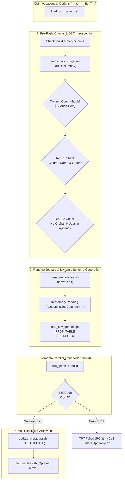

# TPT_LOADER - User How-To & CLI / Jobvars Reference

## 1. Overview & Operational Role

The **TPT_LOADER** framework (`load_csv_generic.sh`) is the Tier-3 high-performance data ingestion engine of the `DATA_LOADER` architecture. It wraps the **Teradata Parallel Transporter (`tbuild`)** utility, dynamically generating runtime schemas, enforcing pre-flight column validations, loading at wire speed via FastLoad/MultiLoad, and backfilling technical audit metadata.



---

## 2. Prerequisites & Environment Setup

### 2.1 Teradata Tools and Utilities (TTU)
The following Teradata client utilities must be present on the system `$PATH`:
- `tbuild`: Teradata Parallel Transporter driver.
- `bteq`: Batch Teradata Query processor.
- `tdwallet`: Teradata secure credentials wallet (optional if `$TD_PASSWORD` is used).

```bash
# Verify binaries
command -v tbuild >/dev/null && echo "tbuild OK" || echo "tbuild MISSING"
command -v bteq >/dev/null && echo "bteq OK" || echo "bteq MISSING"
```

### 2.2 Shell Environment Variables
The loader reads global environment settings from `/sg/local/sid/home/Dsidadm/DATA_LOADER/PROCESSING_TOOLS/TPT_LOADER/config/global.env` and user profile exports:
- `TDPID`: Teradata system name / gateway COP.
- `TDENV`: Database environment prefix (e.g. `DEV0`).
- `SID_ADM_USER`: Admin user name (e.g. `SIDFINADM`).
- `TD_USER`: Defaults to `${TDENV}${SID_ADM_USER}`.
- `DB_STG`: Default staging database suffix (`SIDFINSTG`).
- `DB_WRK`: Default utility work database suffix (`SIDFINWRK`).

---

## 3. Command-Line Reference

### 3.1 Syntax
```bash
./load_csv_generic.sh -f <file|pattern> -t <table> [options]
```

### 3.2 CLI Options Reference Table

| Flag | Argument | Default | Description |
|---|---|---|---|
| `-f` | `<path\|pattern>` | *Mandatory* | Data file path or quoted wildcard (e.g. `"*invoice*.csv"`). |
| `-t` | `<table>` | *Mandatory* | Target staging table name (e.g. `ERP_MSH_INVOICE_HEADER`). |
| `-m` | `replace\|append` | `replace` | Ingestion mode: `replace` (FastLoad `DELETE ALL`) or `append` (MultiLoad). |
| `-d` | `<database>` | `${TDENV}SIDFINSTG` | Target staging database. |
| `-k` | `<utility_db>` | `${TDENV}SIDFINWRK` | Database hosting utility tables (`LG_`, `ET_`, `UV_`, `WT_`). |
| `-u` | `<user>` | `${TDENV}${SID_ADM_USER}` | Teradata logon username. |
| `-s` | `<delimiter>` | `,` | Text field delimiter character. |
| `-S` | `<skip_rows>` | `1` | Number of header rows to skip (set to `0` for headless CSVs). |
| `-Y` | `<Y\|N>` | `N` | Skip header rows on every file when loading wildcards (`SkipRowsEveryFile`). |
| `-B` | `<batch_id>` | Auto-extracted | Value for `INFA_BATCH_ID` audit column. |
| `-T` | `<timestamp>` | Auto-extracted | Value for `INFA_LAST_REPLICATED` audit column (`YYYY-MM-DD HH:MM:SS`). |
| `-e` | `<error_limit>` | `1` | Max allowable rejected rows before aborting job. |
| `-r` | `<instances>` | `1` | DataConnector reader instances. |
| `-l` | `<instances>` | `1` | Load/Update operator instances. |
| `-x` | `<sessions>` | `8` | Maximum Teradata sessions for the consumer operator. |
| `-w` | `<work_dir>` | `tmp/tpt_work` | Local directory for temporary `jobvars.txt` and run logs. |
| `-C` | None | `N` | Skip redundant BTEQ `DBC.ColumnsV` pre-check when pre-validated by Orchestrator. |
| `-M` | `<0\|2>` | `2` | Explicit `HAS_META` audit columns count override when used with `-C`. |
| `-a` | `<archive_dir>` | None | Optional directory to move source files after successful load. |
| `-v` | `<file>` | None | Job variables config file providing default values. |

---

## 4. Execution Examples

### Example 1: Standard Single-File Load (Replace Mode)
```bash
./load_csv_generic.sh \
  -f /sg/local/sid/home/Dsidadm/DATA_LOADER/DATA/LOADING_ZONE/file_userpvo-batch000000011.csv \
  -t ERP_MSH_USER \
  -B 000000011 \
  -T "2026-10-15 12:00:11" \
  -m replace \
  -S 1
```

### Example 2: Multi-Chunk Wildcard Load with Solution A (Headless)
```bash
./load_csv_generic.sh \
  -f "/sg/local/sid/home/Dsidadm/DATA_LOADER/DATA/LOADING_ZONE/*invoiceheaderextractpvo*.csv" \
  -t ERP_MSH_INVOICE_HEADER \
  -B 000000011 \
  -T "2026-10-15 12:00:11" \
  -m replace \
  -S 0
```

### Example 3: Incremental Load (Append Mode)
```bash
./load_csv_generic.sh \
  -f /sg/local/sid/home/Dsidadm/DATA_LOADER/DATA/LOADING_ZONE/file_userpvo-delta.csv \
  -t ERP_MSH_USER \
  -m append \
  -S 1
```

---

## 5. In-Memory Metadata Padding & Dynamic Schema

### 5.1 Dynamic Schema Generation (`FROM TABLE DELIMITED`)
`load_csv_generic.tpt` automatically infers schema from the target table:
```tpt
DEFINE SCHEMA TGT_SCHEMA FROM TABLE DELIMITED @TargetTable;
```
Every column is read as a delimited text string sized to match the physical column definition in Teradata. The Teradata database engine performs high-speed native type conversions during the block transfer.

### 5.2 In-Memory Audit Column Padding
Source files do not contain the audit columns `INFA_BATCH_ID` and `INFA_LAST_REPLICATED`. To avoid generating massive disk write overhead:
1. `FILE_READER` sets `AcceptMissingColumns = 'Y'`.
2. When `HAS_META == 2`, `generate_jobvars.sh` sets `RecordErrorFile = ""` to prevent writing millions of warning lines to disk.
3. The Teradata DataConnector pads the missing audit columns with `NULL` in memory at wire speed.
4. `update_metadata.sh` immediately backfills the batch ID and extract timestamp via a targeted BTEQ SQL statement.

---

## 6. Table Lock Recovery Utility (`unlock_tpt_table.sh`)

When a FastLoad or MultiLoad job terminates abnormally, Teradata places the target staging table in a **Locked / Paused** state (Error 2652).

### Syntax
```bash
./unlock_tpt_table.sh -t <table> -m replace|append [-d <database>] [-u <user>] [-B <batch_id>] [-T <timestamp>]
```

### Replace Mode Lock Release (FastLoad Paused)
In `replace` mode, Teradata requires the interrupted job to be resumed to completion or dropped. The script locates the latest job variables file in `WORK_DIR`, resumes the job via `tbuild`, and then executes `update_metadata.sh` to backfill `INFA_BATCH_ID` and `INFA_LAST_REPLICATED` on the recovered table:
```bash
./unlock_tpt_table.sh -t ERP_MSH_INVOICE_HEADER -m replace -d DEV0SIDFINSTG -B 000000011 -T "2026-10-15 12:00:11"
```

### Append Mode Lock Release (MultiLoad Paused)
In `append` mode, the script issues an administrative `RELEASE MLOAD` statement via BTEQ:
```bash
./unlock_tpt_table.sh -t ERP_MSH_USER -m append -d DEV0SIDFINSTG
```

---

## 7. Troubleshooting & Return Codes

| Exit Code | Meaning | Typical Cause & Diagnostic | Resolution |
|:---:|---|---|---|
| **0** | Success | TPT finished with code 0 or 4 (warning). | Normal completion. |
| **1** | Usage / Pre-Check Error | Missing source file, column count mismatch, or DAT-01 column order mismatch. | Inspect CSV header and `DBC.ColumnsV`. Verify delimiter (`-s`) and skip rows (`-S`). |
| **2** | Connection / Table Error | Invalid logon credentials or target table does not exist in staging database. | Verify `$TDPID`, tdwallet password, and verify table exists via BTEQ. |
| **3** | TPT Execution Failure | TPT job failed (RC 8 or 12), Error 2652 table lock, or metadata update failed. | Check `PrivateLog` via `tlogview -j <jobid> -f load_log`. Run `unlock_tpt_table.sh`. |
