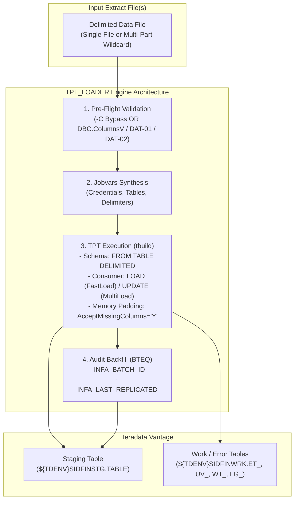
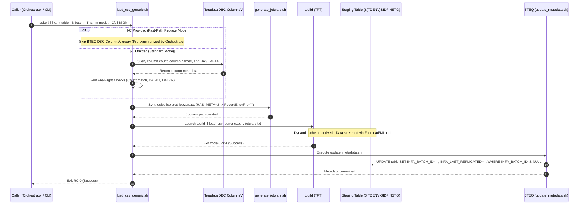

# TPT_LOADER - Functional Specification

## 1. Business & Functional Objective

The **TPT_LOADER** (`load_csv_generic.sh`) provides a generic, metadata-driven bulk loading framework feeding **Teradata Vantage** from flat-file extracts. Rather than requiring distinct, handcrafted load scripts for every database table, TPT Loader leverages dynamic schema derivation, fast-path BTEQ pre-check bypass (`-C -M 2`), and in-memory padding to load any staging table using a single, parameterized engine.



---

## 2. Core Functional Responsibilities

### What TPT Loader Does:
1. **Dynamic Schema Derivation**: Automatically reads target table definitions from Teradata metadata (`DEFINE SCHEMA TGT_SCHEMA FROM TABLE DELIMITED @TargetTable`), eliminating manual column mappings.
2. **Fast-Path Schema Pre-Check Bypass (`-C -M 2`)**:
   - When invoked by `DATA_INGESTION_ORCHESTRATOR`, table structure is already pre-synchronized via JIT Schema Guard.
   - Passing `-C` bypasses the BTEQ `DBC.ColumnsV` introspection query in `replace` mode, eliminating redundant database round-trips.
   - In `append` mode, even when `-C` is passed, the `DAT-02` metadata null-check is strictly enforced to protect existing records from corruption.
3. **Pre-Flight Structural Validation (Standalone / Default)**:
   - When `-C` is omitted, compares file column count against Teradata catalog `DBC.ColumnsV`.
   - **DAT-01 named column alignment**: When `SkipRows > 0`, checks position-by-position that CSV header column names match Teradata staging column names.
   - **DAT-02 append safety**: In append mode, checks that no pre-existing rows have `INFA_BATCH_ID IS NULL` before loading, preventing accidental metadata overwrites.
4. **Dual Loading Engines**:
   - **Replace Mode (`FastLoad`)**: Issues `DELETE ALL` on the target table, then loads at maximum wire speed using Teradata's block-level `LOAD_OPERATOR`.
   - **Append Mode (`MultiLoad`)**: Inserts new records into existing tables without dropping prior data using Teradata's `UPDATE_OPERATOR`.
5. **Zero-Disk Metadata Padding**: Allows source files without technical audit columns to be ingested without file manipulation (`AcceptMissingColumns = 'Y'`). DataConnector pads missing columns in memory with `NULL`. When `-M 2` is set, `RecordErrorFile = ""` suppresses disk logging of missing audit columns.
6. **In-Database Audit Backfill**: Issues a targeted SQL `UPDATE` via BTEQ setting `INFA_BATCH_ID` and `INFA_LAST_REPLICATED` on newly loaded rows (`WHERE INFA_BATCH_ID IS NULL`).
7. **Automatic Cleanup**: Automatically drops leftover utility tables (`ET_`, `UV_`, `WT_`, `LG_`) from prior runs before loading.

---

## 3. End-to-End Processing Sequence



---

## 4. Pre-Flight Integrity Contracts (DAT-01 & DAT-02)

### 4.1 DAT-01: Positional & Named Column Alignment Check
In flat-file loading, a file might have the correct *number* of columns, but an upstream ERP extract change might have reordered them (e.g. `INVOICE_DATE` and `GL_DATE` swapped). Without validation, FastLoad silently loads data into wrong columns.
- **Contract**: When `SkipRows > 0` and `-C` is not passed, `bteq_check.sh` reads line 1 of the data file, sanitizes each header column name via `clean_column_name()` (stripping whitespace/quotes, converting `[^A-Za-z0-9_]` to `_`, collapsing consecutive `_`, and converting to uppercase—identical to `schema_guard.py`), and verifies that every column name matches `DBC.ColumnsV` in the exact ordinal position.
- **Behavior**: If column 14 is `INVOICE_NUM` in CSV but `VENDOR_ID` in the table, the job immediately aborts with exit code `1` before launching TPT.

### 4.2 DAT-02: Append Mode Metadata Guard
In `append` mode, technical metadata is backfilled with:
```sql
UPDATE target_table
SET INFA_BATCH_ID = '...', INFA_LAST_REPLICATED = '...'
WHERE INFA_BATCH_ID IS NULL;
```
If a prior job crashed or an uncommitted batch left rows with `INFA_BATCH_ID IS NULL`, a subsequent append would overwrite older rows with newer batch IDs.
- **Contract**: Before launching MultiLoad in `append` mode (even when `-C` is specified), `bteq_check.sh` queries:
  ```sql
  SELECT COUNT(*) FROM target_table WHERE INFA_BATCH_ID IS NULL;
  ```
- **Behavior**: If count $>0$, the script halts with exit code `1`, requiring an operator to inspect or repair the table.

---

## 5. Dual Engine Architecture: Replace vs. Append

| Feature | Replace Mode (`-m replace`) | Append Mode (`-m append`) |
|---|---|---|
| **TPT Consumer Operator** | `LOAD_OPERATOR` (FastLoad) | `UPDATE_OPERATOR` (MultiLoad) |
| **Preparation Phase** | `DELETE ALL` on target table via DDL operator | Target table preserved |
| **Throughput** | Maximum wire speed (block-level direct write) | High-speed multi-session parallel inserts |
| **Table Lock State** | FastLoad Paused on crash | MultiLoad Paused on crash |
| **Unlock Mechanism** | Resume job & backfill audit metadata via `unlock_tpt_table.sh -m replace -B <id> -T <ts>` | `RELEASE MLOAD` via `unlock_tpt_table.sh -m append` |
| **Use Case** | Full snapshot extracts (default staging) | Delta / CDC extracts |

---

## 6. Audit Metadata Population

All staging tables contain two mandatory technical audit columns:
1. `INFA_BATCH_ID VARCHAR(100)`: The unique batch identifier of the extract.
2. `INFA_LAST_REPLICATED TIMESTAMP(0)`: The exact timestamp when Oracle Fusion exported the data.

### Extraction & Backfill Logic
1. **Batch ID**: Passed via `-B <id>` or extracted from the filename pattern `-batch<id>-`.
2. **Timestamp**: Passed via `-T "<YYYY-MM-DD HH:MM:SS>"` or extracted from the filename `YYYYMMDD_HHMISS`.
3. **Backfill Execution**:
   ```sql
   UPDATE DEV0SIDFINSTG.ERP_MSH_INVOICE_HEADER
   SET INFA_BATCH_ID = '000000011',
       INFA_LAST_REPLICATED = '2026-10-15 12:00:11'
   WHERE INFA_BATCH_ID IS NULL;
   ```
This completes the audit trail, ensuring that downstream dbt models and data marts can track data lineage back to the precise upstream BICC export.
