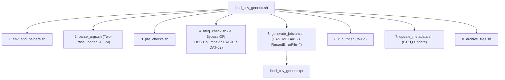

# TPT_LOADER - Technical Manual & Codebase Inventory

## 1. Internal Architecture & Modular Framework

The **TPT_LOADER** framework is implemented as a modular POSIX Bash framework (`lib/`) orchestrating the Teradata client tool suite:

```
TPT_LOADER/
├── load_csv_generic.sh           # Main Entrypoint Wrapper
├── unlock_tpt_table.sh           # Standalone Table Unlock Utility (Error 2652)
├── jobvariables_template.txt     # Template for TPT job variables
├── config/
│   └── global.env                # Default environment variables & DB names
└── lib/                          # Specialized modular bash components
    ├── env_and_helpers.sh        # Logging (log, die), clean_column_name, path normalization
    ├── parse_args.sh             # Two-pass configuration & CLI argument parsing (-C, -M)
    ├── pre_checks.sh             # Binary presence, file existence, regex parsing
    ├── bteq_check.sh             # Fast-path bypass (-C) or DBC.ColumnsV query & DAT-01/02
    ├── generate_jobvars.sh       # Runtime jobvars.txt synthesis & memory padding (HAS_META=2)
    ├── load_csv_generic.tpt      # Parameterized generic TPT script
    ├── run_tpt.sh                # Execution of tbuild & return code parsing
    ├── update_metadata.sh        # BTEQ metadata backfill (INFA_BATCH_ID / TS)
    └── archive_files.sh          # Post-load file movement to archive
```



---

## 2. Complete Codebase & Script Inventory

### 2.1 Main Wrapper: `load_csv_generic.sh`
- **Path**: `load_csv_generic.sh`
- **Role**: Coordinates the sourcing of modules under strict shell safety (`set -o pipefail`).

---

### 2.2 Module: `lib/env_and_helpers.sh`
- **Path**: `lib/env_and_helpers.sh`
- **Role**: Standardized logging, exit handling, SQL identifier validation, literal escaping, and header column sanitization.
- **Key Functions**:
  1. `log(level, message)`: Prints timestamped log lines formatted as `YYYY-MM-DD HH:MM:SS [LEVEL] message`.
  2. `die(code, message)`: Logs message at `ERROR` level and exits shell immediately with `exit ${code}`.
  3. `validate_identifier(val, label)`: Enforces `^[A-Za-z0-9_]+$` on SQL identifiers (`TARGET_DB`, `TARGET_TABLE`, `WRK_DB`).
  4. `escape_sql_literal(val)`: Escapes single quotes (`'` $\rightarrow$ `''`) before SQL interpolation.
  5. `clean_column_name(col_raw)`: Sanitizes CSV header column names (`[^A-Za-z0-9_]` $\rightarrow$ `_`, deduplicates `_`, uppercase) in 100% parity with `COMMON/dataloader_core/schema_reader.py`.

---

### 2.3 Module: `lib/parse_args.sh`
- **Path**: `lib/parse_args.sh`
- **Role**: Implements a robust **two-pass configuration loader**:
  - **Pass 1**: Loads defaults from `config/global.env` and optional `-v <jobvars>` configuration file (including `SkipRowsEveryFile`, `SkipBteqCheck`, `HasMeta`).
  - **Pass 2**: Parses explicit CLI flags (`-f`, `-t`, `-m`, `-B`, `-T`, `-S`, `-Y`, `-C`, `-M`), overriding defaults.
  - Sanitizes quotes and whitespace from arguments.
  - Recognizes `-C` (`SKIP_BTEQ_CHECK="Y"`) and `-M <has_meta>` (`CLI_HAS_META="${OPTARG}"`).

---

### 2.4 Module: `lib/pre_checks.sh`
- **Path**: `lib/pre_checks.sh`
- **Role**: Pre-execution validation:
  1. Verifies that `tbuild` and `bteq` executables exist in system `$PATH`.
  2. Verifies that input data files or wildcards resolve to existing files.
  3. Extracts batch ID and timestamp via regex patterns if `-B` or `-T` were omitted.
  4. Resolves credentials: checks `$TD_PASSWORD` first; if unset, uses Teradata Wallet syntax `\$tdwallet(${TD_USER})`.

---

### 2.5 Module: `lib/bteq_check.sh`
- **Path**: `lib/bteq_check.sh`
- **Role**: Performs pre-flight database introspection via BTEQ or fast-path bypass:
  1. **Fast-Path Bypass (`-C`)**: If `SKIP_BTEQ_CHECK == "Y"`, assigns `HAS_META="${CLI_HAS_META:-2}"` and skips querying `DBC.ColumnsV`.
  2. **DBC Introspection**: When `-C` is omitted, queries `DBC.ColumnsV` for target table column count (`NBCOL`) and checks presence of audit columns (`HAS_META = 2`).
  3. **DAT-01 named column alignment check**: When `SkipRows > 0` and `-C` is omitted, iterates through CSV header columns and compares each column name and ordinal position against `DBC.ColumnsV`.
  4. **DAT-02 append safety check**: When `LOAD_MODE = 'append'` and `HAS_META == 2`, queries `SELECT COUNT(*) FROM table WHERE INFA_BATCH_ID IS NULL`. If count $>0$, halts immediately to avoid historical data corruption (enforced even if `-C` is specified).

---

### 2.6 Module: `lib/generate_jobvars.sh`
- **Path**: `lib/generate_jobvars.sh`
- **Role**: Synthesizes the runtime `jobvars.txt` in an isolated directory `${WORK_DIR}/LOAD_<TABLE>_<RUN_TS>/`:
  1. Creates job directory with restricted permissions (`chmod 700`).
  2. Selects consumer operator: `LOAD_OPERATOR` (replace) or `UPDATE_OPERATOR` (append).
  3. **In-Memory Padding Logic**: When `HAS_META == 2`, sets `RecordErrorFile = ""` to prevent Teradata DataConnector from dumping millions of padding warnings to disk while padding columns in memory.
  4. Writes connection parameters, target table names, work table names (`LG_`, `ET_`, `UV_`, `WT_`), delimiter, skip rows, and tuning limits.
  5. Restricts file permissions to `chmod 600`.

---

### 2.7 TPT Job Template: `lib/load_csv_generic.tpt`
- **Path**: `lib/load_csv_generic.tpt`
- **Role**: Generic Teradata Parallel Transporter definition file.
- **Components**:
  - `DEFINE SCHEMA TGT_SCHEMA FROM TABLE DELIMITED @TargetTable;`: Dynamically derives schema from Teradata dictionary.
  - `DDL_OPERATOR`: Issues `DELETE ALL` on target table in replace mode and drops leftover work/error tables (`3807` error ignored).
  - `FILE_READER`: `DATACONNECTOR PRODUCER` with `Format = 'Delimited'`, `AcceptMissingColumns = 'Y'`, and double-quote handling.
  - `LOAD_OPERATOR`: FastLoad bulk consumer operator for replace mode.
  - `UPDATE_OPERATOR`: MultiLoad consumer operator for append mode.
- **Job Steps**:
  - Step 1: `Truncate_Target` (replace mode only).
  - Step 2: `Cleanup_Previous_Run`.
  - Step 3: `Load_Data`.

---

### 2.8 Module: `lib/run_tpt.sh`
- **Path**: `lib/run_tpt.sh`
- **Role**: Launches `tbuild`:
  ```bash
  tbuild -f load_csv_generic.tpt -v jobvars.txt -j LOAD_<TABLE>_<TS>
  ```
- Evaluates exit code:
  - Codes `0` (Success) and `4` (Warning) are treated as successful completions.
  - Codes `8` (Fatal) and `12` (Error) trigger job failure and exit code `3`.

---

### 2.9 Module: `lib/update_metadata.sh`
- **Path**: `lib/update_metadata.sh`
- **Role**: If `HAS_META == 2`, executes targeted BTEQ SQL to backfill technical metadata on newly loaded rows:
  ```sql
  UPDATE ${TARGET_DB}.${TARGET_TABLE}
  SET INFA_BATCH_ID = '${BATCH_ID}',
       INFA_LAST_REPLICATED = '${META_TS}'
  WHERE INFA_BATCH_ID IS NULL;
  ```

---

### 2.10 Module: `lib/archive_files.sh`
- **Path**: `lib/archive_files.sh`
- **Role**: If `-a <archive_dir>` was passed, moves loaded files to the destination archive directory.

---

### 2.11 Recovery Tool: `unlock_tpt_table.sh`
- **Path**: `unlock_tpt_table.sh`
- **Role**: Unlocks tables left locked (Error 2652) by crashed TPT runs:
  - In `append` mode: Issues `RELEASE MLOAD <table_name>;` via BTEQ.
  - In `replace` mode: Finds the latest `jobvars.txt` in `WORK_DIR`, resumes the interrupted FastLoad job via `tbuild`, queries `HAS_META` from `DBC.ColumnsV`, and sources `lib/update_metadata.sh` to backfill `INFA_BATCH_ID` and `INFA_LAST_REPLICATED` on the recovered table.

---

## 3. Teradata System Catalog & Utility Tables

### 3.1 Utility Tables in `${TDENV}SIDFINWRK`
Every TPT job manages four technical tables in the utility database:
1. `LG_<TABLE>`: Log table tracking job checkpoints and restart vectors.
2. `ET_<TABLE>`: Error Table 1 (captures phase 1 data conversion and formatting errors).
3. `UV_<TABLE>`: Error Table 2 (captures phase 2 uniqueness constraint violations).
4. `WT_<TABLE>`: Work table used during MultiLoad processing.

### 3.2 Pre-Flight Query on `DBC.ColumnsV`
```sql
SELECT 'NBCOL=' || TRIM(COUNT(*)) (TITLE '')
FROM DBC.ColumnsV
WHERE DatabaseName = '${TARGET_DB}' AND TableName = '${TARGET_TABLE}';

SELECT 'HAS_META=' || TRIM(COUNT(*)) (TITLE '')
FROM DBC.ColumnsV
WHERE DatabaseName = '${TARGET_DB}' AND TableName = '${TARGET_TABLE}'
  AND ColumnName IN ('INFA_BATCH_ID', 'INFA_LAST_REPLICATED');

SELECT 'COLNAME=' || TRIM(ColumnName) (TITLE '')
FROM DBC.ColumnsV
WHERE DatabaseName = '${TARGET_DB}' AND TableName = '${TARGET_TABLE}'
  AND ColumnName NOT IN ('INFA_BATCH_ID', 'INFA_LAST_REPLICATED')
ORDER BY ColumnId;
```
